# 模组简介

原版 Minecraft 中无法搭建量子计算机. 而其他的与量子学有关的模组又过于高深. 这个模组解决了这样的问题. **量子蛋** 只加入了一种方块, 一种物品. 正如红石火把, 红石中继器, 红石比较器的堆叠可以组成红石计算机, 这些物品也足以让你建成量子计算机.

# 添加内容

| 类型 | 名称 |
|:-:|:-:|
| 方块 | 量子盒子 (Quantum Box)|
| 物品 | 量子蛋 (Quantum Egg) |

## 量子盒子

量子盒子是模组的核心方块, 是量子运算的载体.

### 生成

量子盒子不会生成在世界中.

### 获取

可用两个紫水晶碎片 + 玻璃合成获得.

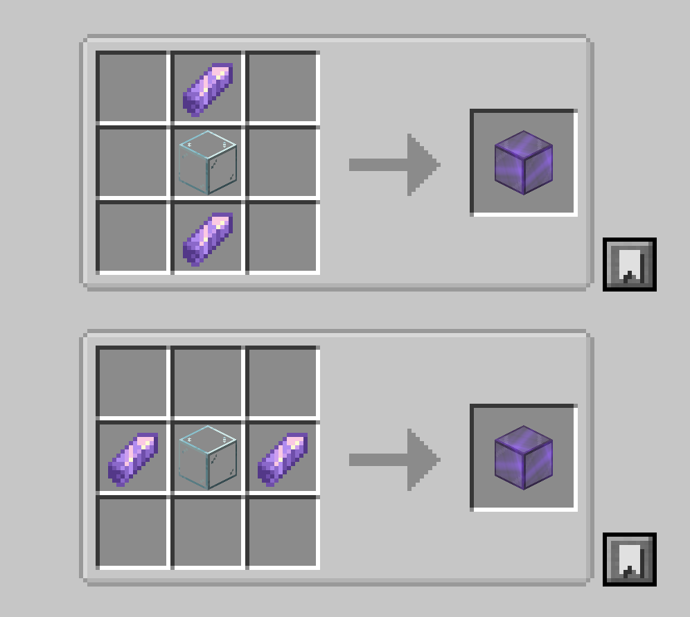

### 破坏

没有工具可以加速对量子盒子的挖掘. 用任何物品或者工具破坏此方块都会掉落自身.

### 用途

量子盒子是一种材质与原版 Minecraft 的遮光玻璃完全相同的透明方块. 与遮光玻璃不同, 量子盒子根本不遮光. 它具备普通的类似玻璃方块的特性, 它的六面均完整, 可以用于支撑需要完整方块面的方块, 比如火把, 红石粉和灯笼. 它无法被任何方式充能以传导红石信号, 附着在该方块上的爬墙红石粉不能向下传输信号.

#### 容器

量子盒子只有一个物品槽位, 而且这个物品槽位最多只能放下一个物品, 无论这种物品的最大堆叠数是多少.

量子盒子没有界面. 对着量子盒子按下使用键可以将手中的一个物品放入盒子中. 如果手里是空的, 可以把盒子中的物品拿到手上. 只能用主手交互. 即使在创造模式, 把东西放入盒子的时候手里的物品也会消耗.

用漏斗可以往任意面输入一个物品 (当然, 原版漏斗只能从四周或者顶面输入). 漏斗矿车或者漏斗可以从任意面从中取走一个物品 (原版情况下只能从地面吸取).

当放入物品的时候, 这个物品会出现在方块的中央, 并像是掉落物那样在方块中旋转.

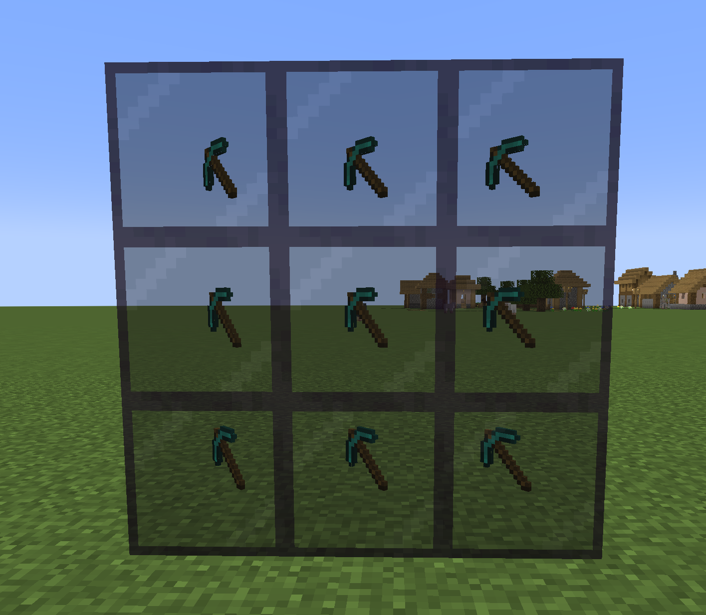

作为 Java 版的容器, 量子盒子虽然看起来像是玻璃, 但是并不能被活塞推动, 当然也不能被粘液块黏住.

然而, 与原版容器不同. 比较器并不是用于检测盒子中是否装有物品, 而是用于测量量子态. 详见下面的 "被比较器检测" 章节.

#### 红石原件

严格意义上说, 量子盒子与原版的所有红石元件都不尽相同. 红石电源可以发出红石信号, 红石用电器接收到红石信号, 但是量子盒子检测的是它的周围方块的红石信号, 并做出行为. 单纯的让量子盒子本身接收到红石信号产生的效果是不一样的, 取决于你怎么激活. 但是出于习惯, 我们还是把 "周围格子接收到红石信号" 叫做这个 "激活" 量子盒子.

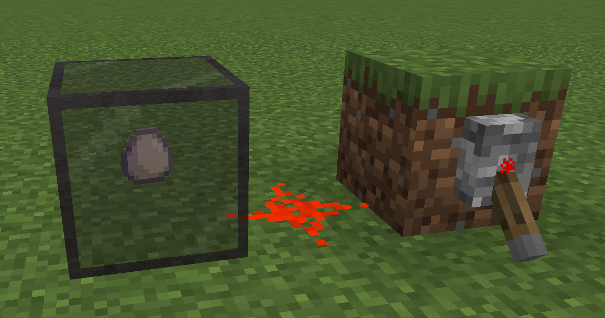
*被红石粉直接指向的量子盒子会被激活, 红石粉的能量被认为是量子盒子该方向上的信号强度*

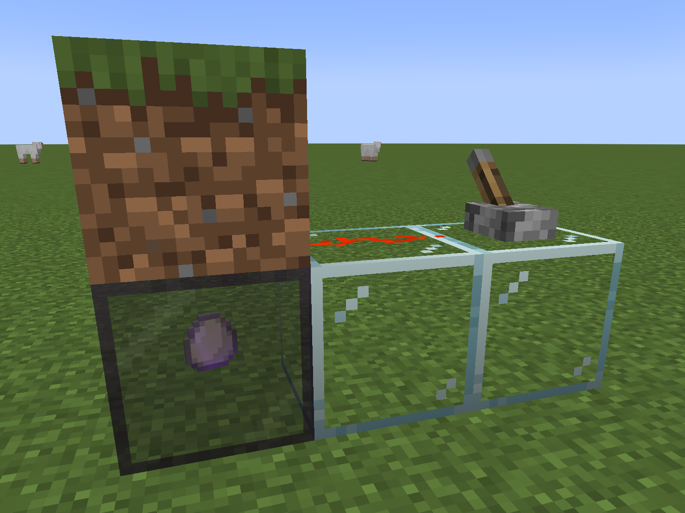
*与弱充能方块相邻的量子盒子会被激活, 弱充能方块的能量等级被认为是量子盒子该方向上的信号强度*

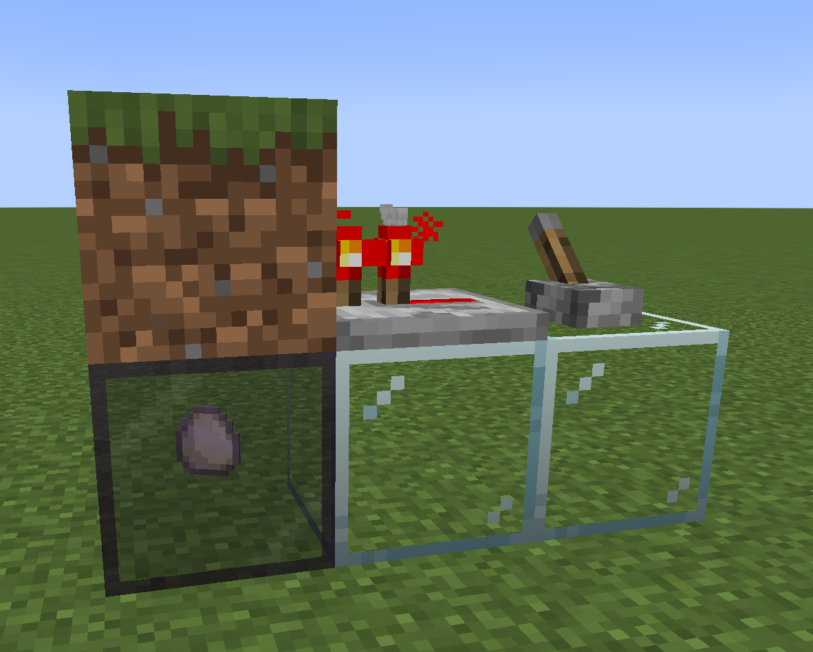
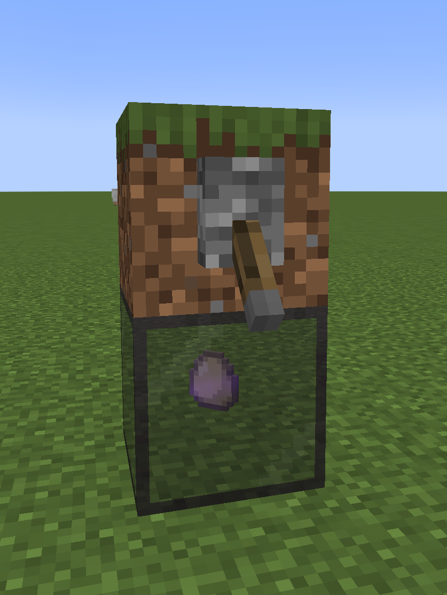
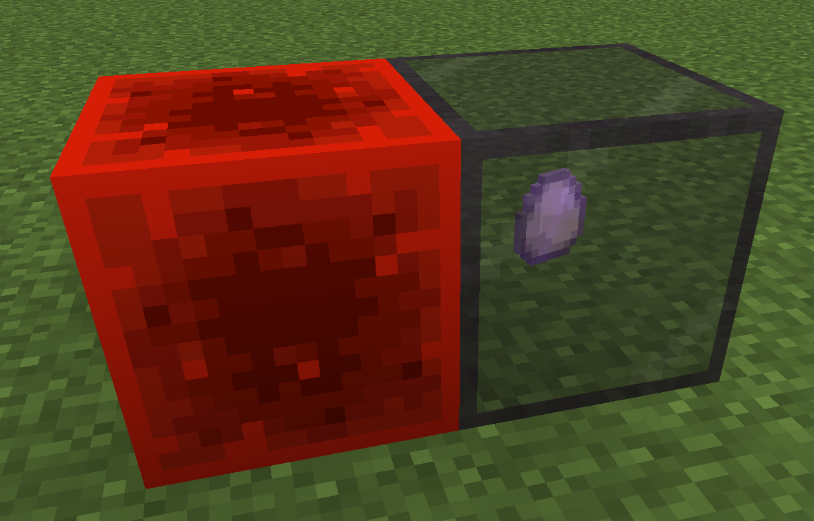
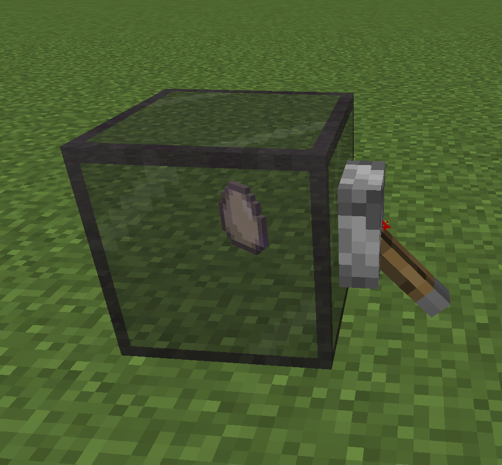
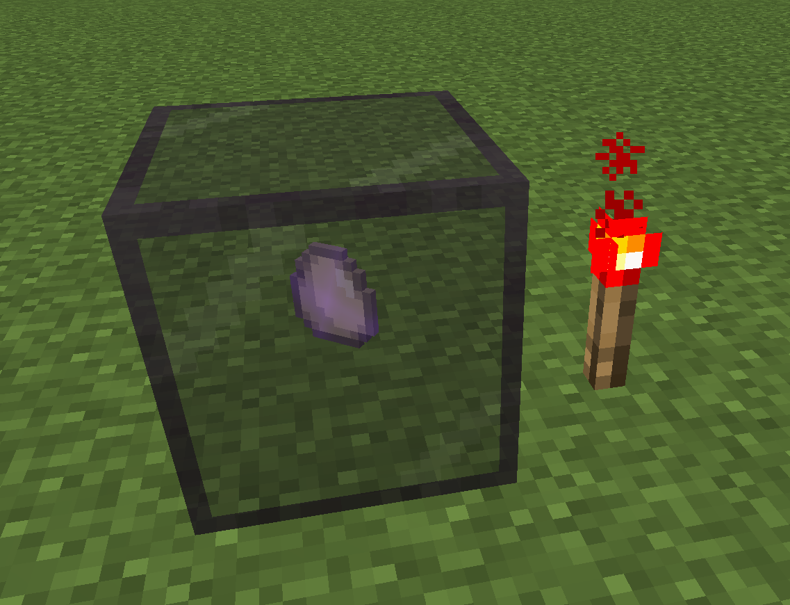
*与强充能方块相邻的量子盒子会被激活, 强充能方块的能量等级被认为是量子盒子该方向上的信号强度*

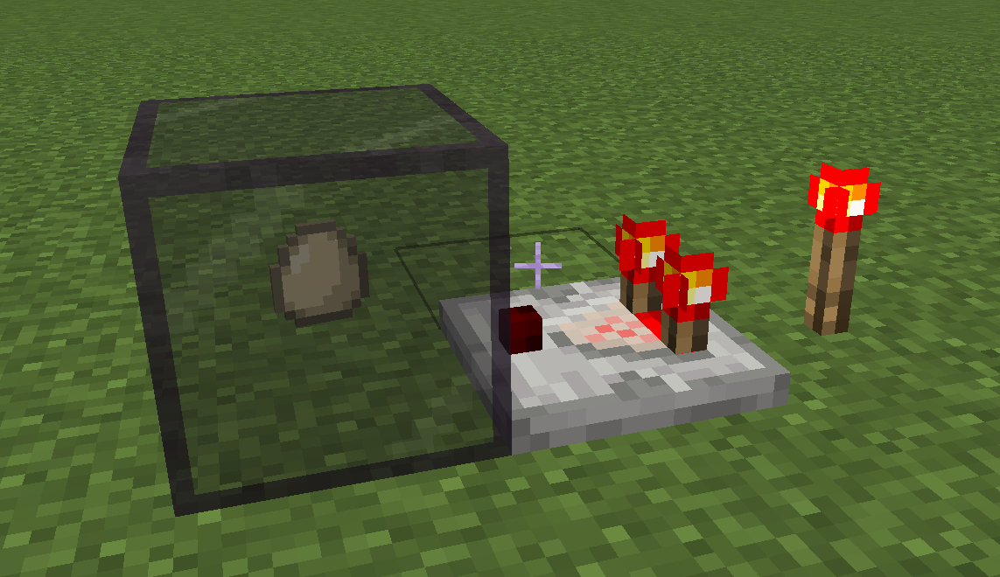
*直接用比较器或者中继器对着该方块并不能激活量子盒子*

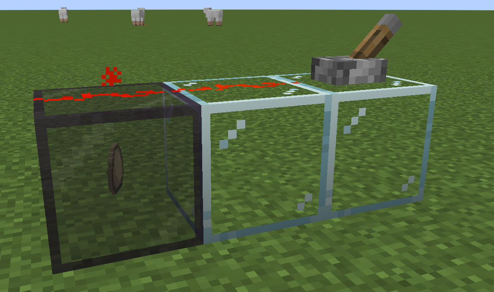
*在量子盒子上方的红石粉无法激活量子盒子*

周围 6 个面方向上的方块都没有被红石充能的状态, 转换到到周围 6 个面方向上至少有一个方块被红石充能的状态, 这个过程叫做上升沿. 当上升沿到来, 量子盒子根据其内容物进行一系列不同的行为:

**当内容物为鸡蛋**
如果内容物是鸡蛋, 当盒子被激活后, 鸡蛋会被替换为量子蛋.

**当内容物为量子蛋**
如果内容物是量子蛋, 盒子被激活后, 会根据 6 个面上方块的充能等级来进行量子旋转 (详见后面的机制 - 量子旋转).

- 设东, 西, 南, 北, 上, 下面的方块的充能等级分别为 `E`, `W`, `S`, `N`, `U`, `D`.
- 则 x 轴的旋转量大小 `rx` 为 `max(E, W)`, z 轴的旋转量大小 `rz` 为 `max(S, N)`, y 轴的旋转量大小 `ry` 为 `max(U, D)`
- 然后, 若 `rx` 大于0, 则将量子蛋所代表的量子比特的 bloch 向量绕 x 轴旋转 `rx * 22.5°` 
- 否则, 若 `rz` 大于0, 则绕 z 轴旋转 `rz * 22.5°`
- 否则, 绕 y 轴旋转 `ry * 22.5°`

这个机制说明, 不同方向上的方块被同时充能的时候, 转动轴的优先级关系是 x > z > y

同时, 如果量子蛋的 uuid 还未分配 (值为 -1), 那么它将会被分配一个 uuid. 同时数据组件 "measured" 被设定为 0.

**当内容物为TNT**
当内容物为 TNT 时, 盒子被激活后, 会清除所有的量子纠缠关系. 这会使得全世界大部分量子蛋的状态出现错误. 但是这种出错并不是不可控的, 而是有一定的规则. 详见后面的机制 - 全局量子态.

然后盒子中的 TNT 物品会消失, 同时盒子会散发出少量烟花粒子效果.

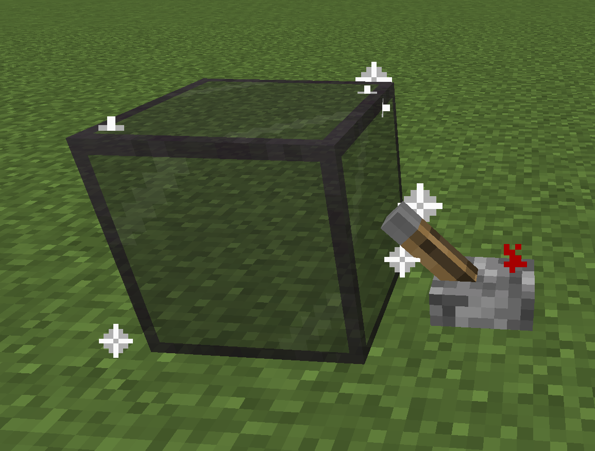

**当盒子为空或装着其他物品**
量子盒子会开始按照东 -> 南 -> 西 -> 北 -> 上 -> 下的顺序遍历周围紧邻的其他方块, 如果发现两个装有量子蛋的量子盒子, 就会对这两个盒子装着的量子蛋进行量子 CNOT 操作 (详见下面的 机制 - CNOT). 率先被遍历到的盒子装着的蛋成为控制端, 随后第二个被遍历到的蛋成为目标端. 同时, 这两个蛋的 "measured" 数据组件被设定为 0. 如果存在蛋的 "uuid" 仍然为 -1 (初始化状态), 则它会被分配一个 uuid

如果 CNOT 被挂起, 但是没有成功进行, 则会冒出几个村民愤怒的粒子效果.

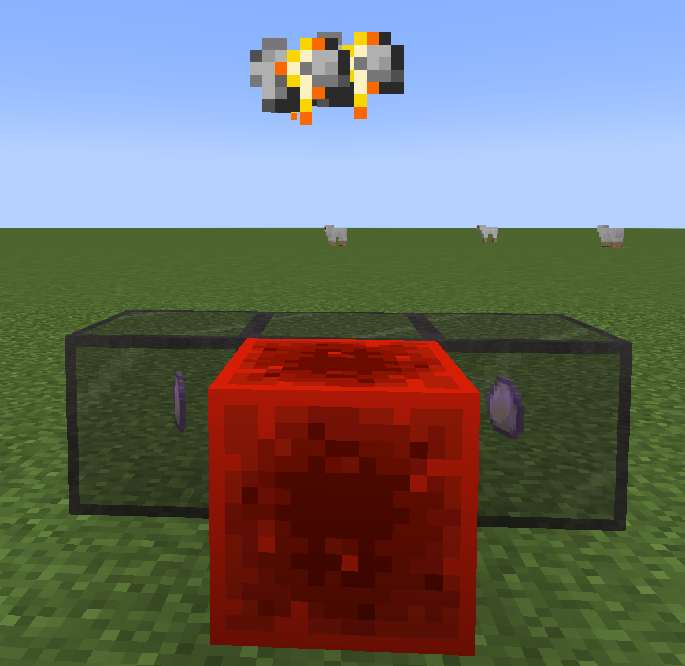

#### 被比较器检测

- 如果量子盒子中放的根本不是量子蛋, 比较器检测它的输出结果始终为 0.
- 如果存放物是量子蛋, 而且 "measured" 数据组件数值等于 1, 那么, 根据该物品的 "bz" 数组组件字段的值判断比较器的输出结果.
  - 如果 "bz" 是 -1.0, 那么输出 15 级信号
  - 否则, 输出 0
- 如果存放物是量子蛋, 但是 "measured" 数组组件数值等于 0, 那么对该量子比特进行测量. (详见下面的 机制-测量). 然后 "measured" 被设定为 1. 然后根据 "bz" 字段的值给出输出结果. 与上面的情况相同.

## 量子蛋

量子蛋是模组的核心物品, 是量子比特的基本载体.

量子蛋的材质就是原版鸡蛋上覆盖了一层附魔光效.

### 获取

量子蛋只能由鸡蛋放入量子盒子转化得到. 将鸡蛋放入量子盒子, 然后激活量子盒子, 就可以将鸡蛋转变为量子蛋. 量子鸡蛋的默认数据组件值如下, 一切用命令或者量子盒子转变获得的量子鸡蛋物品形式的数据值都是如此.

- `minecraft:attribute_modifiers`: `{modifiers:[]}`
- `minecraft:enchantment_glint_override`: `1b` -> 意味着始终带有一层附魔光效
- `minecraft:enchantments`: `{levels:{}}`
- `minecraft:lore`: `[]`
- `minecraft:max_stack_size`: `1` -> 最大堆叠数 1
- `minecraft:rarity`: `"common"` -> 稀有度普通, 对应游戏中白色名称.
- `minecraft:repair_cost`: `0`
- `quantum_egg:bx`: `0.0d` -> 关键字段 "bx", 存储量子态的 bloch 向量的 x 方向投影.
- `quantum_egg:by`: `0.0d` -> 关键字段 "by", 存储量子态的 bloch 向量的 y 方向投影.
- `quantum_egg:bz`: `1.0d` -> 关键字段 "bz", 存储量子态的 bloch 向量的 z 方向投影. 
- `quantum_egg:measured`: `1` -> 关键字段 "measured", 存储量子态是否可以直接被比较器读取, 还是需要先测量.
- `quantum_egg:uuid`: `-1` -> 关键字段 "uuid", 是量子态的凭证. uuid 是懒生成的, 除非量子比特放进量子盒子参与量子计算, 否则不会生成.

### 用途

#### 原材料

量子蛋可以被熔炉加工. 无论量子蛋存放了什么信息, 在熔炉里都可以被烧炼回普通鸡蛋.

#### 存储部分量子比特信息

量子蛋的数据值是具有迷惑性的. 看起来里面包含了一个 bloch 向量的完整存储, 但是实际上, 这个量子蛋存储的信息在大部分情况下不是靠这个 bloch 向量, 而是依赖于全局信息.

bloch 向量只有在这样的场景下才是有效的, 否则可以被认为是垃圾值, 不应被参考:

- 当 "measured" 字段为 1 时, bloch 是权威的.
- 当该量子蛋持有的 uuid 不对应任何的纠缠组的时候 (参见 机制-全局量子态), bloch 是权威的.

而 uuid 是量子比特的唯一身份凭证. 当 bloch 失效的时候, 就是靠着 uuid 去全局寻找真正的量子态. 由于全局状态存储在全局, 所以正常情况下无法通过手段判定一个没有被测量的量子鸡蛋的 bloch 是否有效. 

如果在创造模式下用某些方式创造两个 uuid 完全相同的量子蛋, 而且它们的数据都存放在全局, 它们的关系就好像是真身和快捷方式, 使用起来完全没有区别. 如果你对两个 uuid 相同的量子蛋 (正常生存情况下不应该发生) 进行CNOT, CNOT 会失败并导致量子盒子冒出村民愤怒粒子效果.

如果量子蛋的实际量子态不是存放在 bloch 而是存放在全局, 用各种方式销毁量子蛋 (比如用火烧毁掉落物, 丢进岩浆, 扔进虚空, 投向仙人掌, 炸死, 放在地面上太久被刷掉, 或者用熔炉转化为普通鸡蛋) 会导致量子态泄漏. 这类似于内存泄露, 你失去了对某个量子态的唯一凭证, 但是这个量子态仍然苟活. 量子盒子放入 TNT 可以清除所有的全局量子态的设计目的就是为了防止这种现象持续发生, 导致全局数据量持续上涨而无法减少. 当然, 当全局的量子态被清除的时候, 这些量子蛋的量子态会自动转变为那不靠谱的 bloch, 大部分情况下这会导致量子态错乱. 所以发动 TNT 核平打击的时候最好确认所有可及的量子比特都已经被测量.

# 机制

## 概念解释

### 纠缠组

纠缠组是若干量子比特构成的. 纠缠组内的量子比特构成的量子态无法被拆分为更多个量子态的叉积.

每一个纠缠组存储这些信息:

- 这个纠缠组的所有量子比特所对应的 uuid
- uuid -> 组内位置的查找表.
- 一个长度为 `2^n` 的复数振幅表, 其中 `n` 是该组的量子比特数量. 该表的每一个位置表示一个量子态的振幅.

例如, 一个经典的 2 量子 W 态的纠缠组 (这个组的测量结果必然是一个比特为 `|0>` 另一个为 `|1>`) 就像下面这样. 假如两个量子比特的 uuid 分别是 1 和 2.

- quuid = [1, 2]
- uuid_to_pos = {1: 0, 2: 1}
- state = [0 + 0j, 0.707 + 0j, 0 + 0j, 0.707 + 0j]
  - 解释: `(|01> + |10>)/sqr2 = (0 * |00> + 1/sqr2 * |01> + 1/sqr2 * |10> + 0 * |11>)`

由于经典计算机的架构缺陷, 模拟量子计算机的代价非常高昂. 随着一个纠缠组上限的提升, 内存代价以 `2^n` 级别进行增长, 而时间复杂度则更加远远高于此增速. 因此做出限制, 一个纠缠组的量子数至多为 8.

## 全局量子态

全局量子态由若干纠缠组, 以及一个 uuid -> 纠缠组的对照表组成.

在模组中, 全局量子态是所有量子操作的唯一管理器, 旋转, CNOT, 还是测量, 都必须经由全局管理器进行操作. 之所以必须要由管理器操作, 是因为管理器是唯一能够访问全局纠缠组状态的系统. 当对一个量子比特进行旋转, 参与CNOT, 或者测量的操作, 必须率先查表确定该量子比特的数据是存放在纠缠组中, 还是存放在量子蛋本身持有的 "bx", "by" 和 "bz" 中. 只要查表发现量子比特的数据存放在纠缠组中, 上述操作的权威基准就是存放在全局的纠缠组量子态, 与本地 bloch 向量值完全无关.

量子态从全局转为本地, 或者本地转为全局, 有这样一些方法:

本地转全局的情况:
- 参与 CNOT. 必然会导致 bloch 失效

全局转本地的情况:
- 某些量子旋转. 当发现这个量子比特所在纠缠组只有一个比特的时候, 会释放这个纠缠组并更新该量子比特的 bloch 向量, 然后对该量子比特单独旋转.
- 量子测量. 将会把这个量子比特从组中移除, 更新组的量子态, 然后更新这个量子比特的 bloch 向量为测得值.

全局量子态的另一个功能就是生成 uuid. 每一个 uuid 都是全局唯一的. 每一个参与全局量子态管理器进行计算的量子比特都必须持有一个 uuid. uuid 目前用 Integer 存储, 意味着一个存档最多只有大约 21 亿个量子比特, 包括因为各种原因销毁的. 与全局量子态不同, uuid 一旦发放就无法召回, 如果持有某个 uuid 的量子比特遗失, 这个 uuid 会永远泄露.

## 量子旋转

1. 根据 `uuid` 查找纠缠组 `g = uuid_to_group.get(uuid)`. 如果该 qubit 不在任何纠缠组, 去2. 否则, 去4.
2. 调用`rotate_isolated`:
  - 将传入 bloch 向量转为单量子比特波函数 `bloch_to_state()`
  - 构造旋转矩阵 \(R_x,R_y,R_z\), 矩阵乘法得到总幺正矩阵 U
  - 对单比特状态应用 `apply_single_gate(0,U)`, 实现绕x, y, z轴旋转
  - 执行 `normalize()` 归一化振幅
  - 将新波函数转回 bloch 向量 `state_to_bloch()`
3. 将计算得到新 bloch 拷贝回传入的 bloch 数组. 全局 map 保持不动, qubit 维持孤立状态. `end`
4. 如果组内只有 1 个 qubit (单比特组), 去5. 否则 (多比特纠缠) 去6.

5.
  - 从全局 map 移除该 uuid
  - 在 group 内部调用 `g.rotate(pos=0,ax,ay,az)`: 构造旋转矩阵, 调用`quantum_state_t.apply_single_gate(0,U)`, 再归一化
  - 将 group 波函数转 bloch 向量, 拷贝回 bloch 参数
  - 标记 `markDirty()`, 告诉 Minecraft 数据发生更变, 需要保存. `end`
6. 
  - 通过 `uuid_to_pos(uuid) `拿到该比特在组内波函数下标 `pos`
  - `g.rotate(pos,ax,ay,az)`: 在多比特函数上对下标 `pos` 执行单比特幺正门 `apply_single_gate(pos,U)`, 然后进行归一化.
  - 把 bloch 数组强制改为 {0,0,1} 占位.
  - `markDirty()`标记需要保存数据, `end`

## CNOT 受控非门

受控非门工作原理简介:
```plaintext
mc=1<<pc(控制掩码), mt=1<<pt(目标掩码)
遍历所有基i: 
  如果i的控制比特位是1: out[i] = amp[i ^ mt] (翻转目标比特)
```

1. 如果控制与目标的 uuid 相同, 返回 `false`, `end`
2. 保证两个 qubit 都存在于全局分组映射中:
  - 如果 `cuuid` 不在 map: 用控制比特的 bloch 向量 `cbloch` 创建单比特纠缠组, 注册到`uuid_to_group`
  - 如果 `tuuid` 不在 map: 用控制比特的 bloch 向量 `tbloch` 创建单比特纠缠组, 注册到`uuid_to_group`
3. 获取控制所在组`gc`, 目标所在组`gt`
4. 如果控制和目标比特在同一个组 `gc == gt`, 去5. 否则 (不在同一个组) 去 9.
5. 获取组内下标: `pc = gc.uuid_to_pos(cuuid)`, `pt = gc.uuid_to_pos(tuuid)`
6. 在组内状态执行`gc.cnot(pc,pt)` -> 调用`quantum_state_t.apply_cnot(pc,pt)`
  - apply_cnot 实现逻辑: 遍历全部振幅, 当控制比特位为 1 时, 交换振幅对应目标比特 0/1 分量
7. 调用`organize_group(gc)`:
  - `organize_group`会保存旧分组快照, 然后把该组全部 uuid 从全局 map 移除.
  - 调用`split()`递归尝试对新波函数做可分性检测`try_seperate`, 尽可能拆成互不纠缠的小组.
8. `markDirty()` 告诉全局信息有更改, 返回`true`. `end`.
9. 合并两组: `quantum_group_t.create_union_group(gc,gt)`
  - 内部执行张量积: `g1.state.tensor(g2.state)`, 拼接两组 uuid 列表, 得到新大组`ug`
10. 计算新组内下标: `pc`沿用 gc 内部下标, `pt = gt内下标 + gc.qcnt`
11. 在合并后的大组执行`ug.cnot(pc,pt)`
12. 调用`organize_group(ug)`:
  - 尝试对 CNOT 之后的联合波函数做自动 split 解纠缠
  - 若拆分后子分组存在超过 max_size=8, 回档到旧状态, 返回`false`. 否则`markDirty()`, 返回`true`, `end`

## 量子比特测量

测量会坍缩量子态. 测量后的 qubit 脱离纠缠组, 测量结果以 bloch 向量返回, `{0,0,1}`代表 0, `{0,0,-1}`代表 1

1. 查找纠缠组`g = uuid_to_group.get(uuid)`. 如果 qubit不在任何纠缠组, 去2. 否则去3.
2. 直接调用`measure_isolated(bloch)`
  - p0=(1+bloch[2])/2, 按照概率随机坍缩到|0>(0,0,1) 或 |1>(0,0,-1), 覆写原来的 bloch 值. `end`
3. 找到该 qubit 所存在于的组 g, 将该 uuid 从 `uuid_to_group`map 移除.
4. 如果组只有 1 个 qubit, 去 5. 否则去 7.
5. 将组量子态转为 bloch, 再调用`measure_isolated`做概率坍缩, 结果写入 bloch. 
6. `markDirty()` 保存数据. `end`
7. 获取该 qubit 在组内下标`pos = g.uuid_to_pos(uuid)`
8. 调用`g.measure(pos,rng)`
  - `quantum_state_t.measure_at(pos,rng)`
    - 计算测得 0 的总概率 p0 (把 pos 比特为 0 的全部振幅模方求和)
    - 随机数生成器采样得到测量结果 0 或 1
    - 波函数坍缩, 抛弃与测量结果矛盾的基, 对剩余振幅裁剪, 量子比特数 - 1, `normalize()`归一化剩余波函数, 捕获测得值 (0/1)
  - 从`quuid`列表移除该 qubit, `qcnt-1`, 重建`uuid_to_pos_map`映射
  - 返回 bloch 向量, 0 -> `{0,0,1}`, 1 -> `{0,0,-1}`
9. 将返回的 bloch 拷贝到被测量的量子比特.
10. 调用`organize_group(g)`, 对测量后剩下的多比特状态执行 split, 尝试自动解纠缠拆分剩余的 qubit 为更小的组. 更新全局`uuid_to_group`映射
11. `markDirty()` 保存数据, `end`.

## 清空全局量子态

所有的 qubit 的纠缠关系将全部丢弃, 所有的 uuid 失效, 所有量子比特的 bloch 值不会被自动重置, 需要自行测量重置.

uuid 计数器不会被重置, 后续分配继续递增.

1. `uuid_to_group.clear()`清空全部纠缠分组映射
2. `markDirty()` 保存数据

## 内部关键子算法

### 自动解纠缠

由于组内 CNOT 有可能造成纠缠态抵消, 从而导致纠缠组分裂, 为了确保纠缠组内始终维持不可分纠缠态, 需要在每次组内 CNOT 后进行整理. 对于测量亦是如此.

对于组内 CNOT, 不可能产生比原组更大的纠缠组, 所以整理后不需要检查分裂组当中是否有大小超过 8 比特的纠缠组. 测量也是如此, 得到的最终分裂组的每一个的大小均严格小于最初的纠缠组.

但是对于组间 CNOT, 可能两组的比特数之和原本大于上限, 但是实际上纠缠后产生的许多个纠缠组中每一个的大小并不达到上限. 此时不应该直接拦截此 CNOT, 而是正常进行. 除非两个组纠缠后并不产生分裂, 或者分裂产生的块还是过大, 才会导致 CNOT 失败.

# 示例

## 量子门

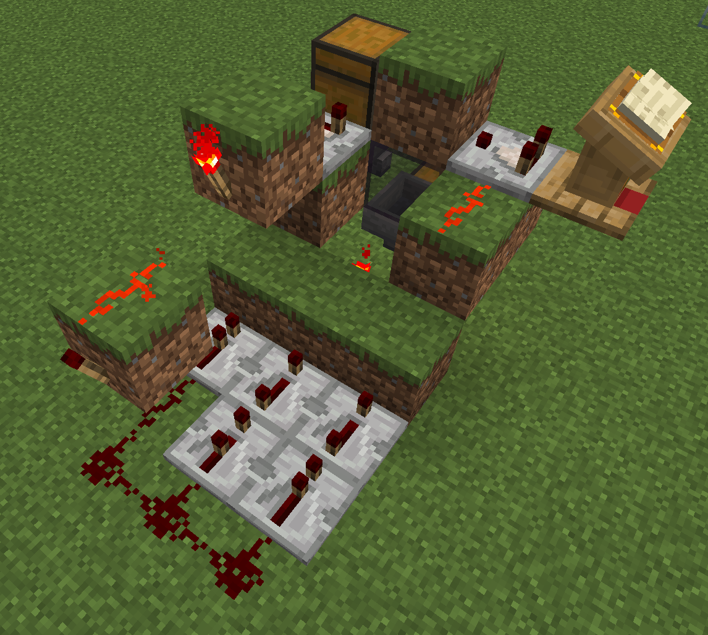
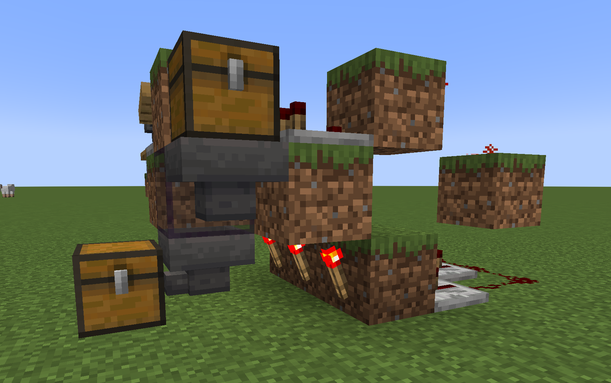

图片中展示的是一种 H 门的设计. 把量子蛋装进上面的箱子里, 就可以从下面的箱子中得到经过 H 门的量子蛋.

当把蛋放入箱子中时, 比较器检测到信号并将其发送给中继器阵列. 中继器阵列依次解锁输入漏斗, 激活量子盒子, 解锁输出漏斗. 前者把蛋送入盒子, 然后盒子进行量子态旋转, 然后输出漏斗倒出产物到目标箱.

由于依赖箱子中物品检测, 所以这个门一次只能转化一个量子蛋. 如果一次放入过多量子蛋, 可能出现不转化或者卡机的情况.

图中的讲台使比较器发出强度为 4 的信号. 可以通过翻页使得比较器发出其他强度. 比如将输出信号调节为 8 就可以让这个门改为完全翻转量子态而不是仅仅转 90°.

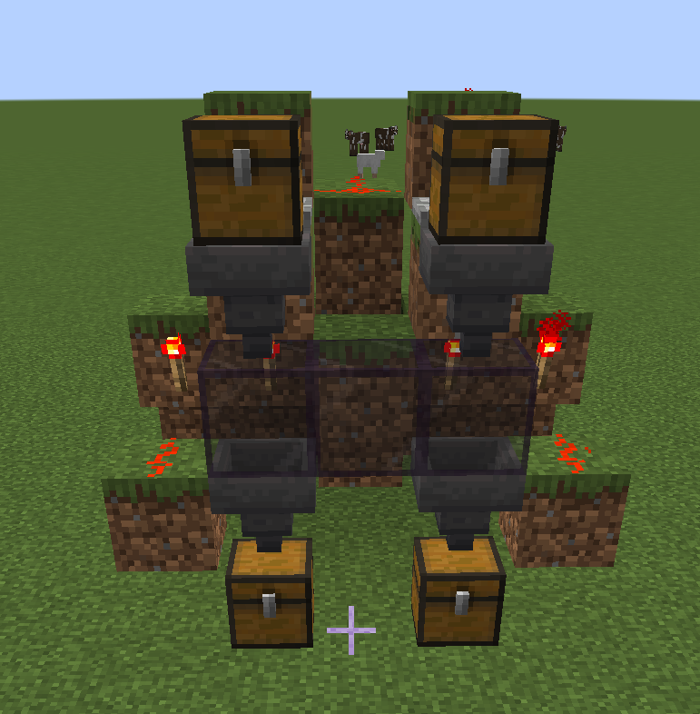
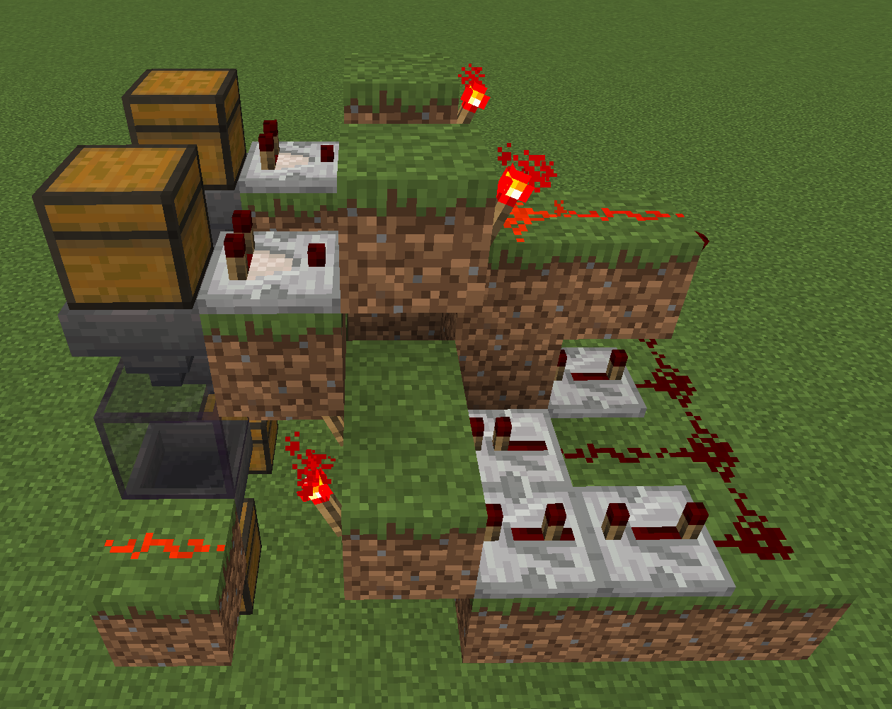
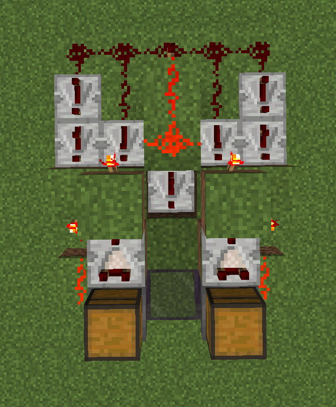

而这是自动 CNOT 门. 当两个箱子里都有物品的瞬间, 比较器发送信号给中继器链, 并依次解锁输入漏斗, 激活中央量子盒子, 最后解锁输出漏斗. 两边的量子蛋依次对应地被存放到对应边的目标箱.

锁定输入漏斗的红石火把同时也对着两侧量子盒子. 但是由于时序卡的很好, 在两边箱子均只有一个量子蛋输入的时候, 并不会在量子蛋位于两盒子中的时间内触发两侧盒子导致误旋转.

机器本身可以旋转, 但是必须确保电路设计的时候确认方向, 避免让 "控制端" 出现在西边或者北边.

## 实验

理论上, 把自动量子门串起来, 就可以形成更复杂的门, 但是这是复杂的工作. 在确保你的算法可行之前, 你最好先手动测试一下, 再开始搭建量子计算机.

你可以很方便地手动尝试一下这些实验, 观察现象, 然后再考虑怎么用电路表达这样的处理流程.

### 制备 2 量子 W 态

2 量子 W 态非常有意思. 处于这样的状态的两个量子蛋的测量结果必然是一个 1 一个 0.

要制作这样的量子态, 首先你需要准备一些基础设施.

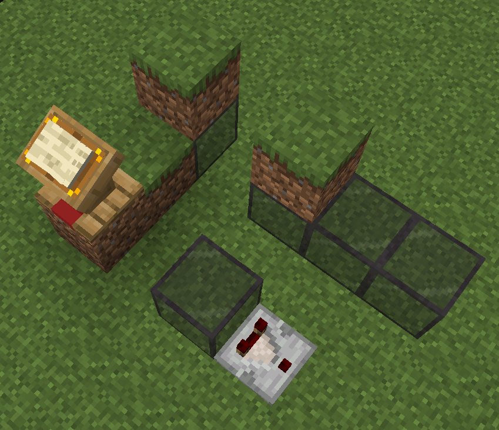

1. 你需要一个基本的量子旋转器. 如图所示 (左). 准备一个讲台, 一本刚好是 15 页的书本. 然后把书本放到讲台上.
2. 你需要一个基本的量子纠缠器. 如图所示 (右). 在地上摆放三个连起来的量子盒子. 然后打开 F3 或者在地上摆放向日葵, 根据东 -> 南 -> 西 -> 北的顺序确认谁是控制端 (在这个列表中靠前的那个量子盒子成为控制端). 作为标记, 在控制端上方放一个方块.
3. 你需要一个量子测量器. 如图所示 (下), 这很简单, 让一个比较器检测一个量子盒子就可以了.

为了区分不同的量子蛋, 避免混在混乱的背包中忘记掉. 你最好安装一个叫做 Component Viewer 的模组. 你可以直接按 alt 打开背包中鼠标指着的物品的数据组件. 然后你就可以看鸡蛋的 uuid 了. 在实验出问题的时候, 你还可以检查 measured 字段或者 bx, by, bz 字段来查看哪里出了问题.

然后你就可以开始了.

1. 拿出两个鸡蛋. 
2. 先把讲台上的书本翻到第四页. 将第一个蛋右键放入旋转器的量子盒子中, 如图所示放上比较器, 使得量子盒子被激活.

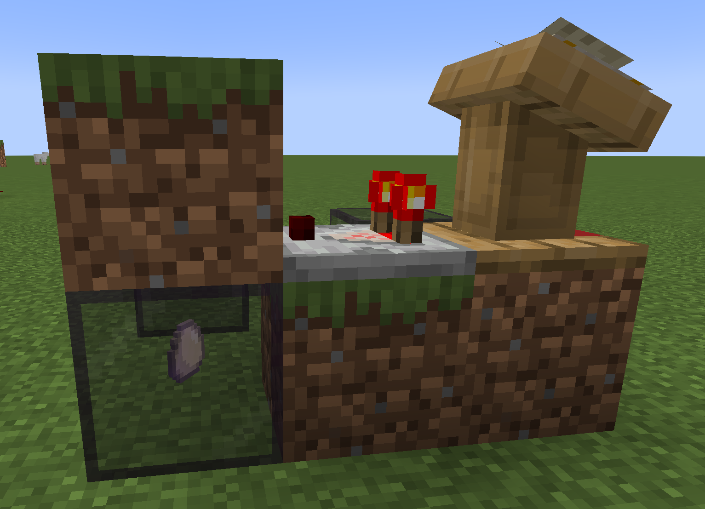

3. 保持蛋处于盒子中. 挖掉比较器, 再放一次, 使得量子态发生旋转.
4. 空手右键拿出此量子蛋. 如果安装了 Component Viewer 模组, 应该可以看到 bx 变成了 1.0, by 和 bz 非常接近 0, 而且 measured = 0
5. 挖掉旋转器上的比较器. 放入第二个鸡蛋. 然后放上比较器. 让第二个鸡蛋变成量子蛋.
6. 然后从旋转器中取出第二个鸡蛋.
7. 把第一个蛋放入量子纠缠器的控制端 (那个有方块标记的一边). 把第二个蛋放入目标端. 然后在中间的量子盒子 (确保它是空的, 至少不能放鸡蛋, 量子蛋或者TNT) 旁边放红石块以激活它. 如图所示.

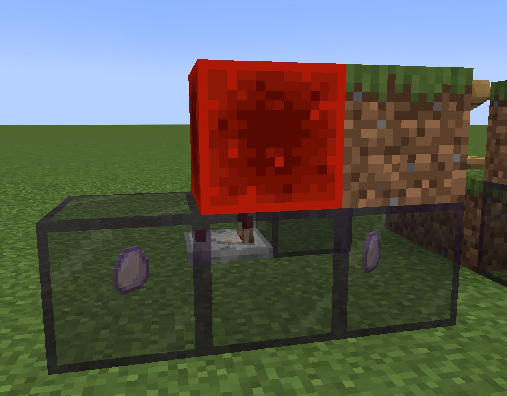

8. 取出两个蛋. 把第二个蛋再次放到旋转器上, 根据之前的方法让第二个蛋再次旋转两次.
9. 然后 2 量子 W 态应该就制备完成了! 把两个量子比特放到比较器里检测一下. 正常来说, 出来的结果应该是一个亮一个不亮. 至于哪一个亮, 都是有可能的. 但是无论你怎么尝试, 肯定有且只有一个比较器亮起.

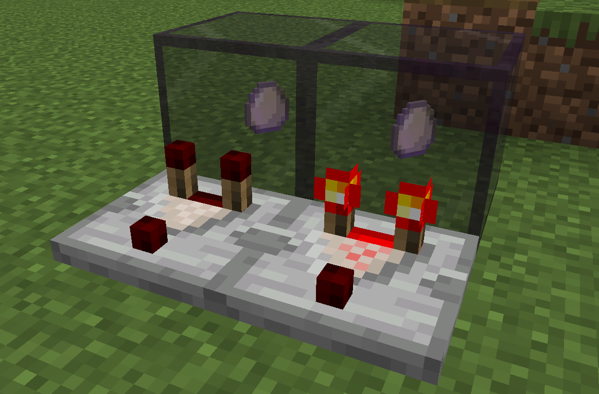

# 提示与技巧

1. 就算你不懂量子力学, 但是你是建筑大佬, 量子盒子不失为一种很好的展示框. 原版的物品展示只能从一个方向看, 但是量子盒子中的物品不仅始终在优雅旋转, 而且可以让里面的物品像是博物馆的展品那样从任何方向都看得到. 有了这个方块, 修建博物馆变得更加容易了一些. 而且量子盒子这个深色的外观非常贴合博物馆略微黑暗的氛围.
2. 利用 H 态量子 (经过 H 门旋转一次的量子比特) 被测量坍缩为 0 和 1的概率均等的规则, 可以制作比投掷器方法更简单的随机数生成机器. 而且可以自由通过量子态的旋转制备更自由的概率分布.